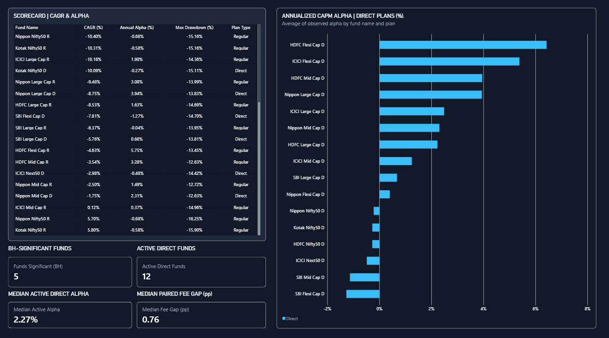
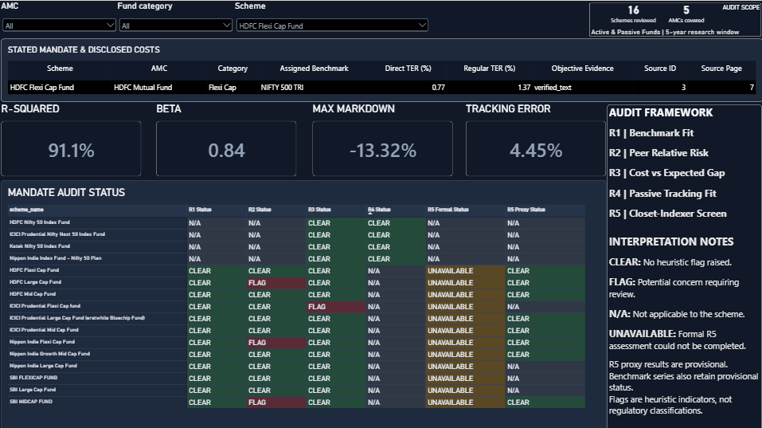

# Mutual Fund Audit

An end-to-end research and analytics project examining Indian mutual fund performance, benchmark-relative risk, investor costs, and mandate-versus-behaviour evidence. The project combines a reproducible Python/PostgreSQL analytical pipeline, statistical testing, document retrieval, a rule-first question router, and a Power BI dashboard.

> **Disclaimer:** This is an educational research and software project, not investment advice, a recommendation to buy or sell securities, or a regulatory audit. Audit flags are analytical screening results, not findings of misconduct or regulatory violations. Results are provisional where benchmark or historical cost data are incomplete.

## Project overview

The research covers a frozen universe of active and passive Indian equity mutual fund schemes over the five-year window from **30 October 2021 to 30 October 2026**.

The analytical work examines:

- Risk-adjusted and benchmark-relative fund performance.
- CAPM alpha and beta, with Newey-West standard errors.
- Multiple-testing control using Benjamini-Hochberg adjustment.
- Return persistence and robustness checks.
- Direct-versus-Regular plan return gaps and disclosed expense ratios.
- Rule-based mandate-versus-behaviour screening.
- Retrieval-augmented answers grounded in AMC documents and factsheets.
- A Power BI dashboard for reviewing results and limitations.

## Research and implementation

### Quantitative research

The quantitative pipeline uses Python and PostgreSQL to process scheme metadata, NAV observations, benchmark total-return-index data, and risk-free-rate assumptions.

The analysis includes annualised return and risk metrics, CAPM regressions, false-discovery-rate adjustment, persistence analysis, matched-plan fee-gap analysis, mandate screens, and sensitivity checks.

### Document retrieval and question routing

The document assistant combines:

- PDF extraction and scheme attribution.
- Fixed-length document chunks.
- Dense retrieval using MiniLM-L6-v2 and FAISS.
- BM25 lexical retrieval.
- Reciprocal Rank Fusion for hybrid retrieval.
- Gemini 3.1 Flash-Lite for evidence-grounded answer generation.

A rule-first router separates questions into four paths:

- **NUM:** Supported numerical queries through fixed SQL templates.
- **DOC:** Document-grounded questions through retrieval.
- **MIX:** Combined numerical audit and document evidence.
- **OOS:** Out-of-scope requests refused by the router.

SQL execution uses a read-only transaction and an allowlisted query-template layer. Document answers are subject to citation validation.

The final B2 retrieval configuration was frozen before heldout evaluation:

| Setting | Frozen value |
|---|---|
| Chunking strategy | Strategy A: Fixed |
| Retrieval mode | Hybrid |
| `top_k` | 5 |
| `fusion_k` | 60 |
| `min_score` | 0.028012 |

## Results at a glance

<!-- RESULTS:START -->
<!-- Generated from results/*.csv by scripts/inject_results.py. Do not edit this block manually. -->

### Quantitative outputs

| Measure | Result |
|---|---:|
| Scheme-plan metric records | 32 |
| Matched Direct-Regular plan pairs | 16 |
| Scheme-level mandate audit records | 16 |

The mandate audit count is scheme-level. Supporting Direct and Regular plan records are not counted as additional schemes.

### B2 question-answer evaluation

| Evaluation split | Questions completed | Hit@5 | MRR | Exact gold-page citations | Numeric exactness | False-refusal rate |
|---|---:|---:|---:|---:|---:|---:|
| Dev (25 questions) | 25/25 | 50.0% | 0.3929 | 50.0% | 100.0% | 0.0% |
| Heldout (10 questions) | 10/10 | 66.7% | 0.5417 | 66.7% | 100.0% | 0.0% |

Evaluation figures are reported separately for development and heldout questions. Heldout results were measured after the retrieval configuration was frozen.
<!-- RESULTS:END -->

The figures above are descriptive project outputs. They should be interpreted alongside the methodology, benchmark qualifications, sample sizes, and limitations below.

## Power BI dashboard

The dashboard contains four analytical pages:

1. Method and Limitations
2. Scorecard
3. Risk and Rolling Analysis
4. Cost Audit

The dashboard file and supporting data are included in the repository.

**Dashboard file:** [`dashboard/MF_Audit_Dashboard.pbix`](dashboard/MF_Audit_Dashboard.pbix)

**Data pack:** [`dashboard/MF_Audit_DataPack.xlsx`](dashboard/MF_Audit_DataPack.xlsx)

### Dashboard screenshots

| Page / visual | Preview |
|---|---|
| Method and Limitations |  |
| Scorecard |  |
| Risk and Rolling |  |
| Cost Audit |  |
| Mandate Audit visual |  |

## Methodology and limitations

The full research design, calculations, assumptions, and retrieval evaluation protocol are documented in:

- [`docs/methodology.md`](docs/methodology.md)
- [`docs/limitations.md`](docs/limitations.md)
- [`docs/architecture.mmd`](docs/architecture.mmd)
- [`docs/data_lineage.md`](docs/data_lineage.md)
- [`docs/preregistration.md`](docs/preregistration.md)

Important limitations include:

- Actual historical BSE 100/500 TRI series were unavailable for eight BSE-dependent scheme records. A provisional estimated-hybrid benchmark was used, constructed from BSE price returns and a matching NIFTY TRI/price dividend wedge. This is not actual BSE TRI.
- NIFTY benchmark results are retained as a separate sensitivity analysis.
- TER comparisons use a 30 September 2026 point-in-time snapshot, not a complete historical five-year TER series.
- Survivorship and historical scheme-code continuity could not be conclusively established.
- The risk-free rate is a constant annual 6% assumption, with 5% and 7% sensitivity checks.
- Formal R5 closet-indexer calibration is unavailable. Any provisional proxy is exploratory and must not be interpreted as a calibrated screen.
- Some document extraction, scheme attribution, and evidence-trace limitations remain.
- The inherited Stage A1 pytest test-collection issue remains unresolved.

These qualifications are part of the research result, not footnotes to be ignored.

## Reproducibility

### Requirements

- Python 3.11
- PostgreSQL
- Project virtual environment at `.venv`
- Source data and configuration files described in the data-lineage documentation
- A configured Gemini API credential for live document-answer generation

Do not commit `.env` or credentials. Start from `.env.example` and configure local secrets privately.

### Environment check

Run from the repository root in PowerShell:

```powershell
.\.venv\Scripts\python.exe --version
.\.venv\Scripts\python.exe -m pytest -q
```

### Dashboard data validation

```powershell
.\.venv\Scripts\python.exe src\validate_dashboard_data.py
```

### Testing

Run the project test suite from the repository root:

```powershell
.\.venv\Scripts\python.exe -m pytest -q
```

Some integration tests require a configured PostgreSQL database. Database-dependent tests should be run only when the local database and project environment are configured.

### B2 evaluation

The B2 retrieval configuration and heldout evaluation are frozen. The committed evaluation outputs are intended to be inspected and reproduced from their documented evidence, not casually regenerated.

Do not rerun heldout evaluation or modify the frozen retrieval configuration as part of routine setup.

## Repository structure

```text
mf-audit/
├── config/              # Project configuration
├── dashboard/           # Power BI dashboard, data pack and screenshots
├── data/                # Source and processed data
├── docs/                # Methodology, limitations, architecture and lineage
├── reports/             # Stage reports and research outputs
├── results/             # Quantitative and evaluation outputs
├── scripts/              # Validation and supporting scripts
├── src/                  # Analysis, retrieval, routing and SQL execution
├── tests/                # Automated tests
├── .env.example          # Environment-variable template
├── Makefile              # Project commands
├── README.md
└── requirements.txt
```

Some directories and files may be omitted from version control where they contain raw source data, generated artifacts, local credentials, or other excluded material. Refer to `.gitignore` and the data-lineage documentation.

## Project status

| Stage | Description | Recorded status |
|---|---|---|
| Stage 0 | Research setup and preregistration | Complete with limitations |
| A1 | Data acquisition and universe construction | PASS (inherited pytest collection issue remains open) |
| A2 | Quantitative metrics and validation | PASS |
| A3 | Statistical analysis and audit framework | Complete with limitations |
| A4 | Power BI dashboard | PASS |
| B1 | Document corpus and retrieval pipeline | Complete with limitations |
| B2 | Retrieval and answer evaluation | PASS |
| C | Packaging, reproducibility and final release | Complete with limitations |

### Stage-status qualification

B1 is recorded as complete with limitations because the Hit@3 acceptance target was not achieved and extraction, metadata, and orchestration limitations remain documented in `reports/stage_B1_report.md`. The retrieval work is complete, but its Hit@3 acceptance target was not met.

B2 is recorded as PASS. Its evaluation evidence and known limitations are documented in `reports/failure_analysis.md`.

## Important interpretation notes

- The mandate audit contains **scheme-level** records. Plan-level supporting records must not be counted as additional distinct schemes.
- The estimated-hybrid benchmark is provisional and must not be described as an actual BSE TRI series.
- Point-in-time TER comparisons do not establish historical expense-ratio behaviour over the entire research window.
- R5 is not a formally calibrated closet-indexer test.
- The document assistant is an evidence-retrieval and research-support tool, not an autonomous investment decision system.
- Audit flags are screening signals requiring contextual review, not proof of wrongdoing.

## Licence

This repository is licensed under the [MIT License](LICENSE). Copyright (c) 2026 Jatin Godiya. The licence permits use, modification, distribution, sublicensing, and sale subject to its notice and warranty-disclaimer conditions.
